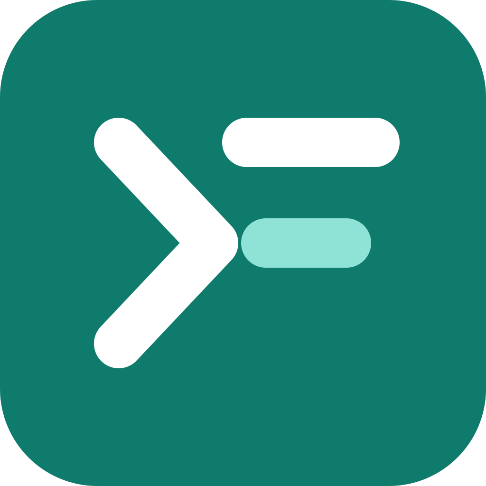

<a id="readme-top"></a>

<!-- PROJECT SHIELDS -->
[![Status][status-shield]][roadmap-url]
[![Platform][platform-shield]][platform-url]
[![.NET][dotnet-shield]][dotnet-url]
[![License][license-shield]][license-url]
[![Offline][offline-shield]][network-url]


<!-- PROJECT LOGO -->
<br />
<div align="center">
  <a href="https://github.com/Rambo19911/FreexComp">
    
  </a>

  <h3 align="center">FreexComp</h3>

  <p align="center">
    A free, fully local RAD IDE for Windows: visual form designer, Object Pascal compiler, debugger and data access.
    <br />
    <a href="help/"><strong>Read the help pages »</strong></a>
    <br />
    <br />
    <a href="https://github.com/Rambo19911/FreexComp/issues/new?labels=bug">Report Bug</a>
    &middot;
    <a href="https://github.com/Rambo19911/FreexComp/issues/new?labels=enhancement">Request Feature</a>
  </p>
</div>


<!-- TABLE OF CONTENTS -->
<details>
  <summary>Table of Contents</summary>
  <ol>
    <li>
      <a href="#about-the-project">About The Project</a>
      <ul>
        <li><a href="#features">Features</a></li>
        <li><a href="#built-with">Built With</a></li>
      </ul>
    </li>
    <li>
      <a href="#getting-started">Getting Started</a>
      <ul>
        <li><a href="#prerequisites">Prerequisites</a></li>
        <li><a href="#installation">Installation</a></li>
      </ul>
    </li>
    <li><a href="#usage">Usage</a></li>
    <li><a href="#project-layout">Project Layout</a></li>
    <li><a href="#roadmap">Roadmap</a></li>
    <li><a href="#network">Network</a></li>
    <li><a href="#contributing">Contributing</a></li>
    <li><a href="#license">License</a></li>
    <li><a href="#contact">Contact</a></li>
    <li><a href="#acknowledgments">Acknowledgments</a></li>
  </ol>
</details>


<!-- ABOUT THE PROJECT -->
## About The Project

<!-- SCREENSHOT: add an image at assets/screenshots/ide-main.png, then uncomment:
[![FreexComp IDE][product-screenshot]](#about-the-project)
-->

FreexComp is a rapid application development environment for native Windows programs. You design a form
visually, write Object Pascal, press Run, and get a real x64 executable, without installing a commercial toolchain,
an SDK or a C runtime.

Why FreexComp:
* **Free and local.** No account, no activation, no telemetry, no cloud. Everything runs on your machine, offline.
* **Native output.** The compiler emits LLVM IR and links real Windows executables and DLLs that call Win32 directly.
* **One tool from form to program.** Designer, editor, build, debugger and data access live in one window.

> [!WARNING]
> FreexComp is in active development and has not had a public release yet. Expect missing features and
> breaking changes. See the [roadmap](#roadmap).

<p align="right">(<a href="#readme-top">back to top</a>)</p>

### Features

| Area | What you get today |
|---|---|
| IDE | Main window with docking tool windows, light and dark themes, projects and project groups, build configurations |
| Code editor | Syntax highlighting, code completion, navigation, folding, error markers |
| Compiler | Object Pascal for Windows x64: console and GUI programs, units, DLLs, generics, interfaces, COM support |
| Form designer | Visual design with Object Inspector; the saved form compiles to the same layout at run time |
| UI framework | Native Windows controls written in Object Pascal on top of Win32 |
| Debugger | Breakpoints, stepping, locals and call stack |
| Data access | SQLite with data-aware controls |

<!-- Extend this table as backlog features land. -->

<p align="right">(<a href="#readme-top">back to top</a>)</p>

### Built With

* [![C#][csharp-shield]][dotnet-url] .NET 10: compiler front end, language service, build engine, IDE
* [![Avalonia][avalonia-shield]][avalonia-url] Avalonia with AvaloniaEdit: the IDE user interface
* [![LLVM][llvm-shield]][llvm-url] LLVM (clang, lld, lldb-dap): code generation, linking, debugging
* [![SQLite][sqlite-shield]][sqlite-url] SQLite: the first database back end
* Object Pascal: run-time library, UI framework and data access, compiled by FreexComp itself

<p align="right">(<a href="#readme-top">back to top</a>)</p>


<!-- GETTING STARTED -->
## Getting Started

FreexComp is built from source for now. A packaged installer will follow with the first release.

### Prerequisites

- Windows 10 (version 1809 or later) or Windows 11, x64
- [.NET SDK 10.0](https://dotnet.microsoft.com/download/dotnet/10.0)
- [git](https://git-scm.com/)

No Visual Studio, MSVC or Windows SDK is needed. Details: [supported platforms](help/supported-platforms.md).

### Installation

1. Clone the repository
   ```sh
   git clone https://github.com/Rambo19911/FreexComp.git
   cd FreexComp
   ```
2. Download the pinned toolchain (once, needs a network connection)
   ```powershell
   powershell -ExecutionPolicy Bypass -File scripts/bootstrap.ps1
   ```
   This puts the LLVM toolchain, an embeddable Python runtime (used by the debugger back end) and the SQLite DLL into
   `third_party/`. Nothing is installed system-wide.
3. Build
   ```sh
   dotnet build FreexComp.sln
   ```
4. Run the tests (optional)
   ```sh
   dotnet test FreexComp.sln
   ```

<p align="right">(<a href="#readme-top">back to top</a>)</p>


<!-- USAGE EXAMPLES -->
## Usage

Start the IDE:
```sh
dotnet run --project ide/src/FreexComp.Ide
```

Or compile a program from the command line:
```pascal
program Hello;
begin
  WriteLn('Hello from FreexComp');
end.
```
```sh
dotnet run --project compiler/src/opc -- Hello.pas -o Hello.exe
```

More topics:
* [Writing and calling a library](help/libraries.md)
* [Supported platforms](help/supported-platforms.md)

<p align="right">(<a href="#readme-top">back to top</a>)</p>


<!-- PROJECT LAYOUT -->
## Project Layout

| Folder | Contents |
|---|---|
| `compiler/` | Object Pascal compiler (`opc`), build engine (`pbuild`), language service |
| `rtl/` | Run-time library in Object Pascal |
| `ui-framework/` | Native Windows UI framework in Object Pascal |
| `data/` | Data access and data-aware controls |
| `ide/` | The IDE, form designer and Object Inspector |
| `debugger/` | Debugger client |
| `tests/` | Cross-area tests, compiler golden tests, policy tests |
| `help/` | User help pages |
| `scripts/` | Bootstrap and verification scripts |

<p align="right">(<a href="#readme-top">back to top</a>)</p>


<!-- ROADMAP -->
## Roadmap

- [x] IDE shell: main window, code editor, project open and save
- [x] Object Pascal compiler for Windows x64 console programs
- [x] Build and run from the IDE, clickable error messages
- [x] Native Windows UI framework (core controls)
- [x] Visual form designer and Object Inspector
- [x] Debugger: breakpoints, stepping, locals, call stack
- [x] Data access: SQLite and data-aware controls
- [ ] Full feature set (in progress)
    - [x] Build configurations with inheritance
    - [x] DLL projects
    - [ ] COM and Automation
    - [ ] Inline variables with block scope
    - [ ] Windows x86 target
- [ ] First public release with installer

See the [open issues](https://github.com/Rambo19911/FreexComp/issues) for known issues and proposals.

<p align="right">(<a href="#readme-top">back to top</a>)</p>


<!-- NETWORK -->
## Network

FreexComp needs no network connection and opens none on its own; `NETWORK-POLICY.md` lists every feature that is able to open one.

<p align="right">(<a href="#readme-top">back to top</a>)</p>


<!-- CONTRIBUTING -->
## Contributing

Contributions are welcome: bug reports, feature requests and pull requests.

1. Fork the project
2. Create a feature branch (`git checkout -b feature/my-change`)
3. Add a test that fails without your change, then make it pass
4. Make sure `dotnet build FreexComp.sln` and `dotnet test FreexComp.sln` are green
5. Commit (`git commit -m "area: what changed"`) and push the branch
6. Open a pull request

Only dependencies under permissive licenses may be added; list them in `THIRD-PARTY-NOTICES.md` in the same pull request.

<p align="right">(<a href="#readme-top">back to top</a>)</p>


<!-- LICENSE -->
## License
FreexComp is licensed under the Apache License 2.0 (`LICENSE`).
The runtime libraries are licensed under Apache-2.0 WITH LLVM-exception (`LICENSE-RUNTIME`), so programs built with
FreexComp can be distributed without attribution duties from these libraries.
Third-party components are listed in `THIRD-PARTY-NOTICES.txt`.

<p align="right">(<a href="#readme-top">back to top</a>)</p>


<!-- CONTACT -->
## Contact

Rihards Laškovs: [@Rambo19911](https://github.com/Rambo19911)

Project link: [https://github.com/Rambo19911/FreexComp](https://github.com/Rambo19911/FreexComp)

<p align="right">(<a href="#readme-top">back to top</a>)</p>


<!-- ACKNOWLEDGMENTS -->
## Acknowledgments

* [LLVM Project](https://llvm.org/)
* [Avalonia](https://avaloniaui.net/) and [AvaloniaEdit](https://github.com/AvaloniaUI/AvaloniaEdit)
* [SQLite](https://www.sqlite.org/)
* [CommunityToolkit.Mvvm](https://github.com/CommunityToolkit/dotnet)
* [xUnit.net](https://xunit.net/)
* [Shields.io](https://shields.io/)
* README layout based on [Best-README-Template](https://github.com/othneildrew/Best-README-Template)

<p align="right">(<a href="#readme-top">back to top</a>)</p>


<!-- MARKDOWN LINKS & IMAGES -->
[status-shield]: https://img.shields.io/badge/status-pre--release-orange?style=for-the-badge
[roadmap-url]: #roadmap
[platform-shield]: https://img.shields.io/badge/platform-Windows%20x64-0078D6?style=for-the-badge
[platform-url]: help/supported-platforms.md
[dotnet-shield]: https://img.shields.io/badge/.NET-10.0-512BD4?style=for-the-badge
[dotnet-url]: https://dotnet.microsoft.com/
[license-shield]: https://img.shields.io/badge/license-Apache--2.0-blue?style=for-the-badge
[license-url]: LICENSE
[offline-shield]: https://img.shields.io/badge/works-offline-2ea44f?style=for-the-badge
[network-url]: NETWORK-POLICY.md
[csharp-shield]: https://img.shields.io/badge/C%23-512BD4?style=for-the-badge
[avalonia-shield]: https://img.shields.io/badge/Avalonia-8B44AC?style=for-the-badge
[avalonia-url]: https://avaloniaui.net/
[llvm-shield]: https://img.shields.io/badge/LLVM-262D3A?style=for-the-badge
[llvm-url]: https://llvm.org/
[sqlite-shield]: https://img.shields.io/badge/SQLite-003B57?style=for-the-badge
[sqlite-url]: https://www.sqlite.org/
[product-screenshot]: assets/screenshots/ide-main.png
