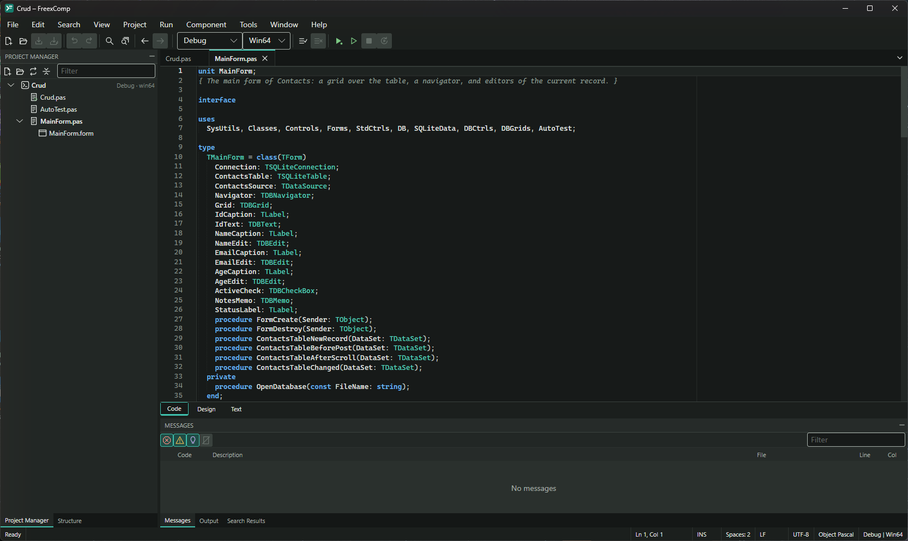
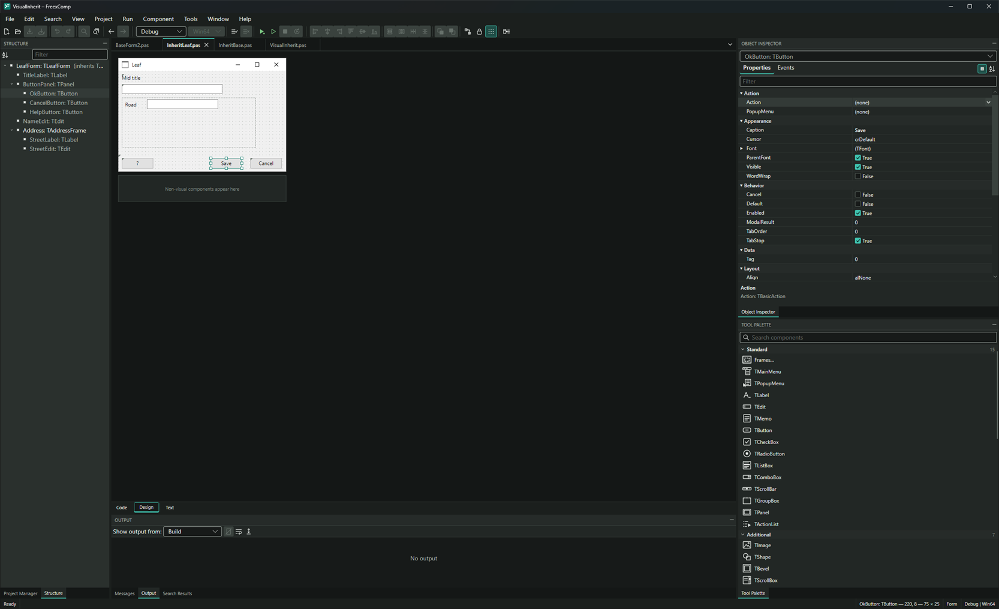

<a id="readme-top"></a>

<!-- PROJECT SHIELDS -->
[![Status][status-shield]][roadmap-url]
[![Platform][platform-shield]][platform-url]
[![.NET][dotnet-shield]][dotnet-url]
[![License][license-shield]][license-url]
[![Offline][offline-shield]][network-url]


<!-- PROJECT LOGO -->
<br />
<div align="center">
  <a href="https://github.com/Rambo19911/FreexComp">
    
  </a>

  <h3 align="center">FreexComp</h3>

  <p align="center">
    A free, fully local RAD IDE for Windows: visual form designer, Object Pascal compiler, debugger and data access.
    <br />
    <a href="help/"><strong>Read the help pages »</strong></a>
    <br />
    <br />
    <a href="https://github.com/Rambo19911/FreexComp/issues/new?labels=bug">Report Bug</a>
    &middot;
    <a href="https://github.com/Rambo19911/FreexComp/issues/new?labels=enhancement">Request Feature</a>
    <br />
    <br />
    <sub>Copyright &copy; 2026 &middot; <a href="LICENSE">Apache License 2.0</a> &middot; runtime libraries: <a href="LICENSE-RUNTIME">Apache 2.0 with LLVM Exception</a></sub>
  </p>
</div>


<!-- TABLE OF CONTENTS -->
<details>
  <summary>Table of Contents</summary>
  <ol>
    <li>
      <a href="#about-the-project">About The Project</a>
      <ul>
        <li><a href="#features">Features</a></li>
        <li><a href="#built-with">Built With</a></li>
      </ul>
    </li>
    <li>
      <a href="#getting-started">Getting Started</a>
      <ul>
        <li><a href="#prerequisites">Prerequisites</a></li>
        <li><a href="#installation">Installation</a></li>
      </ul>
    </li>
    <li><a href="#usage">Usage</a></li>
    <li><a href="#project-layout">Project Layout</a></li>
    <li><a href="#roadmap">Roadmap</a></li>
    <li><a href="#network">Network</a></li>
    <li><a href="#contributing">Contributing</a></li>
    <li><a href="#license">License</a></li>
    <li><a href="#contact">Contact</a></li>
    <li><a href="#acknowledgments">Acknowledgments</a></li>
  </ol>
</details>


<!-- ABOUT THE PROJECT -->
## About The Project

[![FreexComp form designer with Object Inspector and Tool Palette][product-screenshot]](assets/screenshots/ide-designer.png)

<details>
  <summary>More screenshots</summary>
  <br />
  
  <br /><br />
  
</details>

FreexComp is a rapid application development environment for native Windows programs. You design a form
visually, write Object Pascal, press Run, and get a real x64 executable, without installing a commercial toolchain,
an SDK or a C runtime.

Why FreexComp:
* **Free and local.** No account, no activation, no telemetry, no cloud. Everything runs on your machine, offline.
* **Native output.** The compiler emits LLVM IR and links real Windows executables and DLLs that call Win32 directly.
* **One tool from form to program.** Designer, editor, build, debugger and data access live in one window.

> [!WARNING]
> **FreexComp is an experimental product.** Its goal is to build a free alternative to the RAD Studio
> compilers and IDE for Windows. It is in active development and has not had a public release yet: expect
> missing features, rough edges and breaking changes. Do not use it for production work yet. See the
> [roadmap](#roadmap).

FreexComp is an independent clean-room implementation. It contains no code, headers, documentation or assets
of any commercial product, and it is not affiliated with, endorsed by or sponsored by the owner of RAD Studio.
RAD Studio is a trademark of its respective owner and is named here only to describe the goal of the project.

<p align="right">(<a href="#readme-top">back to top</a>)</p>

### Features

| Area | What you get today |
|---|---|
| IDE | Main window with docking tool windows, light and dark themes, projects and project groups, build configurations |
| Code editor | Syntax highlighting, code completion that ranks items of the expected type first, parameter hints, code templates, Go to Declaration, back/forward navigation, find and replace, bookmarks, folding, error markers, source formatter (Format Document, Format Selection, format on save, `.pasformat` style files), local file history with compare and revert |
| Compiler | Object Pascal for Windows x64: console and GUI programs, units, DLLs, generics (also nested in classes and records, qualified names such as `TList<Integer>.TEnumerator`), nested class types, interfaces, COM support, Unicode strings, inline variables, parallel code generation and an on-disk unit cache |
| Form designer | Visual design with Object Inspector; the saved form compiles to the same layout at run time |
| UI framework | Native Windows controls written in Object Pascal on top of Win32, including a rich text editor control and image lists with 32-bit alpha icons, overlays and disabled drawing |
| Debugger | Breakpoints with conditions and pass counts, stepping (also into the library source), Run to Cursor, locals, watches, Evaluate, call stack and threads |
| Data access | Datasets with SQLite and in-memory tables, filters, data-aware controls including a data grid and a navigator |
| Build | Build configurations, pre-build and post-build commands with macros; commands of a project run only after you have trusted it; application icon, version information and named resources set in Project Options |
| Actions | Action lists that drive menus, buttons and tool buttons, shortcuts and secondary shortcuts, ready-made edit and file actions, and an Action List Editor with categories |
| Project groups | Several projects in one group file with one active project; Build All with dependencies first, stop or continue after a failing project, and circular dependencies refused; the same from `pbuild` |
| Platforms | Several target platforms per project with an active platform, per-platform options and output folders; 64-bit Windows is the installed platform today |
| Frames | Reusable form parts designed once and placed on many forms and frames; each instance can change and revert property values and event handlers, and changes to the frame reach every instance |
| Form inheritance | Forms and frames built on other forms and frames of the project (New Inherited Form): inherited controls keep following the ancestor, the descendant adds controls, overrides and reverts values, and its handlers can call the ancestor's |
| Accessibility | Forms and controls describe themselves to screen readers and UI test tools through Windows UI Automation: names, roles, descriptions, tool-button and grid patterns, change events |
| Help | Offline help pages shipped next to the IDE, opened from Help > Contents (F1) |
| Installer | An offline setup program built by `scripts/build-installer.ps1`: per-user install, file associations, Start menu shortcut, clean uninstall; no network |

<!-- Extend this table as backlog features land. -->

<p align="right">(<a href="#readme-top">back to top</a>)</p>

### Built With

* [![C#][csharp-shield]][dotnet-url] .NET 10: compiler front end, language service, build engine, IDE
* [![Avalonia][avalonia-shield]][avalonia-url] Avalonia with AvaloniaEdit: the IDE user interface
* [![LLVM][llvm-shield]][llvm-url] LLVM (clang, lld, lldb-dap): code generation, linking, debugging
* [![SQLite][sqlite-shield]][sqlite-url] SQLite: the first database back end
* Object Pascal: run-time library, UI framework and data access, compiled by FreexComp itself

<p align="right">(<a href="#readme-top">back to top</a>)</p>


<!-- GETTING STARTED -->
## Getting Started

FreexComp is built from source for now. A packaged installer will follow with the first release.

### Prerequisites

- Windows 10 (version 1809 or later) or Windows 11, x64
- [.NET SDK 10.0](https://dotnet.microsoft.com/download/dotnet/10.0)
- [git](https://git-scm.com/)

No Visual Studio, MSVC or Windows SDK is needed. Details: [supported platforms](help/supported-platforms.md).

### Installation

1. Clone the repository
   ```sh
   git clone https://github.com/Rambo19911/FreexComp.git
   cd FreexComp
   ```
2. Download the pinned toolchain (once, needs a network connection)
   ```powershell
   powershell -ExecutionPolicy Bypass -File scripts/bootstrap.ps1
   ```
   This puts the LLVM toolchain, an embeddable Python runtime (used by the debugger back end), the SQLite DLL and
   the Unicode character data file (`UnicodeData.txt`, input of the runtime library's character tables) into
   `third_party/`. Nothing is installed system-wide.
3. Build
   ```sh
   dotnet build FreexComp.sln
   ```
4. Run the tests (optional)
   ```sh
   dotnet test FreexComp.sln
   ```
   A full run takes about 15 minutes. The UI tests open real windows, so run them in a signed-in desktop session
   and leave the mouse and keyboard alone meanwhile. To run one area only, pass its test project, for example
   `dotnet test compiler/tests/FreexComp.Compiler.Tests`.

<p align="right">(<a href="#readme-top">back to top</a>)</p>


<!-- USAGE EXAMPLES -->
## Usage

Start the IDE:
```sh
dotnet run --project ide/src/FreexComp.Ide
```

Or compile a program from the command line:
```pascal
program Hello;
begin
  WriteLn('Hello from FreexComp');
end.
```
```sh
dotnet run --project compiler/src/opc -- Hello.pas -o Hello.exe
```

Help pages (also shown inside the IDE with F1):

| Topic | Pages |
|---|---|
| Forms | [Frames](help/frames.md) · [Form inheritance](help/form-inheritance.md) · [Actions](help/actions.md) · [Accessibility](help/accessibility.md) |
| Projects | [Project groups](help/project-groups.md) · [Platforms](help/platforms.md) · [Build events](help/build-events.md) · [Trusting a project](help/project-trust.md) |
| Resources | [Resource files](help/resource-files.md) · [Image files](help/image-files.md) |
| Libraries | [Writing and calling a library](help/libraries.md) · [Library source](help/library-source.md) · [Debugging and optimised builds](help/debugging.md) |
| Distribution | [Your applications](help/your-applications.md) · [Supported platforms](help/supported-platforms.md) |

<p align="right">(<a href="#readme-top">back to top</a>)</p>


<!-- PROJECT LAYOUT -->
## Project Layout

| Folder | Contents |
|---|---|
| `compiler/` | Object Pascal compiler (`opc`), build engine (`pbuild`), language service |
| `rtl/` | Run-time library in Object Pascal |
| `ui-framework/` | Native Windows UI framework in Object Pascal |
| `data/` | Data access and data-aware controls |
| `ide/` | The IDE, form designer and Object Inspector |
| `debugger/` | Debugger client |
| `tests/` | Cross-area tests, compiler golden tests, policy tests |
| `help/` | User help pages |
| `installer/` | Offline setup program and its tests |
| `scripts/` | Bootstrap, verification and installer build scripts |

<p align="right">(<a href="#readme-top">back to top</a>)</p>


<!-- ROADMAP -->
## Roadmap

Phases 1–7 (IDE shell, compiler, build and run, UI framework, form designer, debugger, data access) are complete.
Phase 8 implements the full feature set for Windows, area by area. Progress counts finished feature items
(updated 2026-11-27; non-Windows platforms are out of scope).

| Area | Done | Progress | Finished so far (☐ = in work) |
|---|---:|---|---|
| Compilers and toolchains | 4 / 26 | `██░░░░░░░░` | Object Pascal compiler for Windows x64 · DLL projects · ☐ Windows x86 target |
| Licensing and notices | 5 / 5 | `██████████` | Licence texts and third-party notices shipped · licence checks for runtime sources, built programs and dependencies |
| Target platforms (Windows) | 2 / 11 | `██░░░░░░░░` | — |
| Styled UI framework | 0 / 130 | `░░░░░░░░░░` | — |
| Native Windows UI framework and designer | 13 / 107 | `█░░░░░░░░░` | Core controls · visual form designer and Object Inspector · tab and page controls with tab positions, multi-line rows, flat buttons and owner-drawn tabs · rich text editor · PNG, JPEG and GIF images · frames · form inheritance · accessibility for screen readers and UI test tools |
| COM and ActiveX | 1 / 18 | `█░░░░░░░░░` | COM-compatible interfaces and calling conventions · ☐ COM servers and Automation |
| AI features | 0 / 31 | `░░░░░░░░░░` | — |
| Visual data binding | 0 / 16 | `░░░░░░░░░░` | — |
| Build and deploy | 11 / 36 | `███░░░░░░░` | Build and run from the IDE, clickable errors · build configurations with inheritance · build events with a trust question · resource scripts and the resource compiler `prc` |
| Language and runtime library | 12 / 118 | `█░░░░░░░░░` | Inline variables and `for var` loops with type inference · dynamic-array constructors, constants, `+`, `Insert`, `Delete` and `Concat` · class constructors and destructors · hardware faults caught by `try` … `except` · `deprecated` / `platform` / `experimental` warnings · runtime library source included |
| IDE | 24 / 120 | `██░░░░░░░░` | Main window, code editor, project open and save · Object Pascal source formatter · project resources, icon and version information pages · code completion that ranks items of the expected type first · local file history with a History window, compare and revert · Structure view with component icons and drag to re-parent · code templates with a shared templates folder and a Templates window · parameter hints for every kind of call · hover documentation with Go to Declaration · Go to Declaration into the runtime library and generated views · live diagnostics with a severity choice · recent files on the Welcome page · light and dark themes · code folding · bracket and directive pair matching · named bookmarks and the Bookmarks window · Tool Palette search · copy a library unit into a project · no-network guarantee checked by tests |
| Source control | 1 / 18 | `█░░░░░░░░░` | Built-in diff viewer (side by side or inline) with Compare with Saved and Compare Files |
| Refactoring and navigation | 0 / 27 | `░░░░░░░░░░` | — |
| Debugging | 5 / 41 | `█░░░░░░░░░` | Breakpoints, stepping, locals, call stack · Step Into library code · value visualisers and a text viewer for strings |
| Unit testing | 0 / 9 | `░░░░░░░░░░` | — |
| Help | 0 / 8 | `░░░░░░░░░░` | Offline help pages in the IDE (first pages) |
| Data access | 1 / 93 | `█░░░░░░░░░` | SQLite and data-aware controls |
| Network clients | 0 / 14 | `░░░░░░░░░░` | — |
| Web front-end framework | 0 / 29 | `░░░░░░░░░░` | — |
| Bundled components | 0 / 6 | `░░░░░░░░░░` | — |
| Local web UI | 0 / 18 | `░░░░░░░░░░` | — |
| **Total** | **79 / 881** | `█░░░░░░░░░` | **9 %** |

- [ ] First public release with installer

See the [open issues](https://github.com/Rambo19911/FreexComp/issues) for known issues and proposals.

<p align="right">(<a href="#readme-top">back to top</a>)</p>


<!-- NETWORK -->
## Network

FreexComp needs no network connection and opens none on its own; `NETWORK-POLICY.md` lists every feature that is able to open one.
An end-to-end test starts the IDE with an empty profile, builds and runs a program and checks that no connection was opened and no sign-in or registration step appeared.

<p align="right">(<a href="#readme-top">back to top</a>)</p>


<!-- CONTRIBUTING -->
## Contributing

Contributions are welcome: bug reports, feature requests and pull requests.

1. Fork the project
2. Create a feature branch (`git checkout -b feature/my-change`)
3. Add a test that fails without your change, then make it pass
4. Make sure `dotnet build FreexComp.sln` and `dotnet test FreexComp.sln` are green
5. Commit and push the branch. Write a short subject line, a blank line, then one `- ` line per change:
   ```text
   ide: Go to Line follows the visible view of a form

   - Go to Line and the caret indicator use the Code or Text view shown
   - Run to Cursor only in Object Pascal source
   - Test: FormTextViewActiveEditorTests
   ```
6. Open a pull request

Keeping a fork up to date:
```sh
git remote add upstream https://github.com/Rambo19911/FreexComp.git
git fetch upstream
git rebase upstream/main
```

The project is a clean-room implementation: do not copy code, headers, documentation or assets from other
products, and do not name commercial products in code or comments.

Only dependencies under permissive licenses may be added; list them in `THIRD-PARTY-NOTICES.md` in the same pull request.

<p align="right">(<a href="#readme-top">back to top</a>)</p>


<!-- LICENSE -->
## License
FreexComp is licensed under the Apache License 2.0 (`LICENSE`).
The runtime libraries are licensed under Apache-2.0 WITH LLVM-exception (`LICENSE-RUNTIME`), so programs built with
FreexComp can be distributed without attribution duties from these libraries.
Third-party components are listed in [`THIRD-PARTY-NOTICES.md`](THIRD-PARTY-NOTICES.md); the plain-text
`THIRD-PARTY-NOTICES.txt` shipped beside the tools is generated from the same data by `scripts/gen-notices.ps1`.

<p align="right">(<a href="#readme-top">back to top</a>)</p>


<!-- CONTACT -->
## Contact

(author and copyright holder): [@Rambo19911](https://github.com/Rambo19911)

Project link: [https://github.com/Rambo19911/FreexComp](https://github.com/Rambo19911/FreexComp)

<p align="right">(<a href="#readme-top">back to top</a>)</p>


<!-- ACKNOWLEDGMENTS -->
## Acknowledgments

* [LLVM Project](https://llvm.org/)
* [Avalonia](https://avaloniaui.net/) and [AvaloniaEdit](https://github.com/AvaloniaUI/AvaloniaEdit)
* [SQLite](https://www.sqlite.org/)
* [CommunityToolkit.Mvvm](https://github.com/CommunityToolkit/dotnet)
* [xUnit.net](https://xunit.net/)
* [Shields.io](https://shields.io/)

<p align="right">(<a href="#readme-top">back to top</a>)</p>


<!-- MARKDOWN LINKS & IMAGES -->
[status-shield]: https://img.shields.io/badge/status-pre--release-orange?style=for-the-badge
[roadmap-url]: #roadmap
[platform-shield]: https://img.shields.io/badge/platform-Windows%20x64-0078D6?style=for-the-badge
[platform-url]: help/supported-platforms.md
[dotnet-shield]: https://img.shields.io/badge/.NET-10.0-512BD4?style=for-the-badge
[dotnet-url]: https://dotnet.microsoft.com/
[license-shield]: https://img.shields.io/badge/license-Apache--2.0-blue?style=for-the-badge
[license-url]: LICENSE
[offline-shield]: https://img.shields.io/badge/works-offline-2ea44f?style=for-the-badge
[network-url]: NETWORK-POLICY.md
[csharp-shield]: https://img.shields.io/badge/C%23-512BD4?style=for-the-badge
[avalonia-shield]: https://img.shields.io/badge/Avalonia-8B44AC?style=for-the-badge
[avalonia-url]: https://avaloniaui.net/
[llvm-shield]: https://img.shields.io/badge/LLVM-262D3A?style=for-the-badge
[llvm-url]: https://llvm.org/
[sqlite-shield]: https://img.shields.io/badge/SQLite-003B57?style=for-the-badge
[sqlite-url]: https://www.sqlite.org/
[product-screenshot]: assets/screenshots/ide-designer.png
